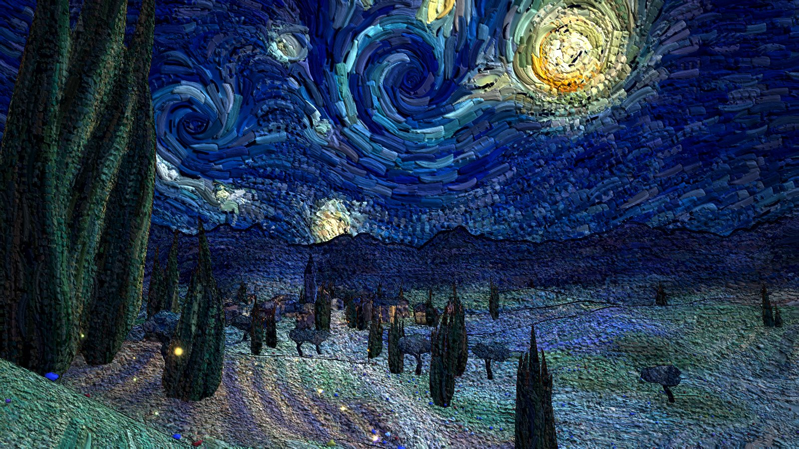

# Impasto

**A walk inside a living Van Gogh painting.**

Wander a hillside near Saint-Rémy, in Provence, painted stroke by stroke in thick oil paint: under the sky of
*The Starry Night*, past flame-like cypresses, down to a lamplit village and a lake. Every surface
is made of brush strokes that stay on the world as you move. The sky is repainted slowly, a stroke
at a time, as if Vincent were still at work on it. Stand still long enough and the painting begins
to dream.



**[Step inside →](https://mpfluger.github.io/impasto/)**

It runs in a desktop browser with WebGL 2 (recent Chrome, Edge or Firefox), keyboard and mouse.
A dedicated graphics card helps; resolution adapts automatically if the frame rate drops.

## Controls

| | |
|---|---|
| **W A S D** / arrows | walk |
| **mouse** | look (held while you're inside the painting) |
| **Shift** | hurry |
| **Space** | float |
| **Esc** | leave fullscreen; in a window, back to the title |
| **F** | fullscreen |
| **1 2 3 4** | night, dawn, day, dusk |
| **T** (hold) | hasten time |
| **P** | lift the paint and see the 3D world beneath |
| **M** | sound on / off |
| **H** | hide the words |
| **X** | back to the title |
| **?** | all of the above |

Stand still for about a dozen seconds, gazing at the sky helps, and the painting starts to dream.

## Running it locally

There is no build step: the page loads its ES modules directly, and Three.js from a CDN.

```sh
npm install
npm start          # http://localhost:5173, caching off so edits show on reload
```

Any static file server works too. Add `?instant` to the URL to skip the title.

| | |
|---|---|
| `npm run lint` | ESLint |
| `npm run test:unit` | world generation, time of day, and facts that must agree across files (Node's test runner) |
| `npm run test:e2e` | boots the page in your installed Chrome: shaders compile, the scene paints, the title and keys work |
| `npm run screenshot` | recaptures `docs/screenshot.jpg` |

CI runs all of it on every push and pull request; pushes to `main` that pass are deployed to
GitHub Pages.

## How it is painted

Nothing is an image file. The world is ordinary 3D geometry, painted every frame in four passes:

1. **Scene.** Each material writes three targets: its colour and material id, a *brush field*
   (the direction a stroke should run on screen: along contours, up the cypress flames, round the
   sky's vortices), and the *stroke it belongs to*. Stroke centres are scattered over each
   surface in world space, spaced by distance so strokes keep a steady size on screen.
2. **Drag.** Colour is smeared along the brush field, giving each stroke the colour beneath it.
3. **Strokes.** Each pixel gathers nearby strokes and draws them as tapered, bristled capsules
   laid along the flow, the most recent on top, each mixed slightly differently, as on a palette.
4. **Finish.** The stroke heights are lit like impasto by the scene's own light, so ridges catch
   it and cast small shadows as you move. Then outlines, bloom, colour drift, a slow ripple, and the
   background bending gently around the edges of nearer things.

The sky follows *The Starry Night*: its eleven stars and crescent moon where the painting has them,
rings of strokes round each vortex, and the dark ultramarine dashes between the light strokes.

## Working on it

Things that aren't obvious from the code:

- **Three.js is pinned in three places** that must agree: the import map URL and its `integrity`
  hash in `index.html`, and `devDependencies` in `package.json` (which tests and tooling use).
  A unit test checks all three. To upgrade, change the version in both files, `npm install`, then
  take the new hash from
  `node -e "console.log('sha384-'+require('crypto').createHash('sha384').update(require('fs').readFileSync('node_modules/three/build/three.module.js')).digest('base64'))"`.
  Dependabot is told to leave `three` alone for this reason.
- **The sky's repaint schedule is written twice**, in `src/glsl.js` (which moment each stroke's
  colour is taken from) and `src/post.js` (when its new paint is drawn in). They must match
  exactly; a unit test compares them. Stroke hashes are rounded to 1/1024 because they travel
  through a half-float texture, and both sides must see the same value.
- **Strokes on moving things** (swaying trees, the dream's heaving hills) are chosen on the
  object's resting shape and carried along with it (`strokeCellMoved`), otherwise they crawl.
- **Material ids** are written to the colour target's alpha (+0.5 means "no outline") and index the
  per-material tables at the top of `src/post.js`. Strokes never cross from one id to another.
- **`window.__painting`** exposes the uniforms, player, time of day and a `debug` object
  (`dream`, `fixedScale`). The browser tests and the screenshot script rely on it.

## Credits

- *The Starry Night* (1889) and the other paintings evoked here are by Vincent van Gogh, in the
  public domain; the lines that surface in the dream are from his letters.
- Built with [Three.js](https://threejs.org/) (MIT). Type set in Cormorant Garamond (SIL Open Font
  License), served by Google Fonts.

## License

[MIT](LICENSE)
